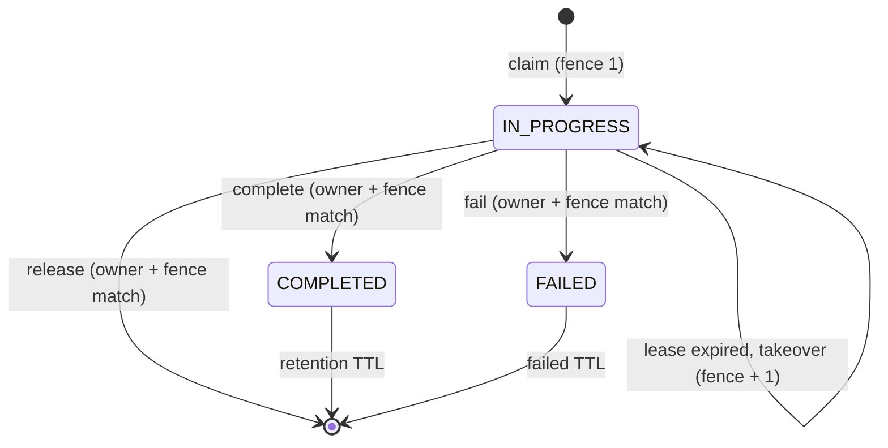
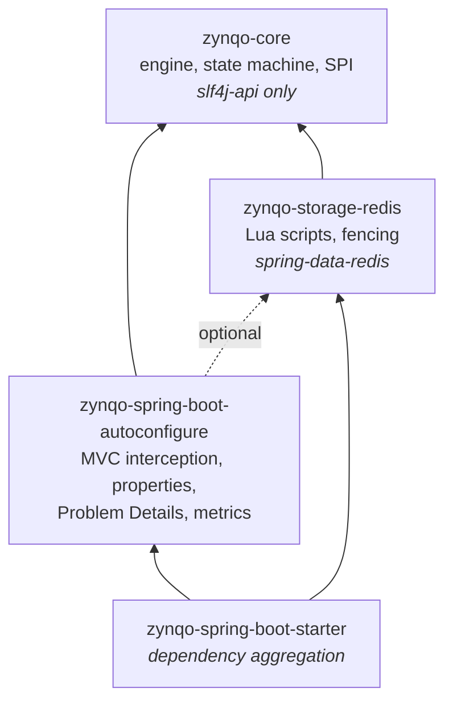

# Zynqo

**Repeat the request. Not the action.**

Zynqo gives Spring Boot MVC APIs declarative, distributed idempotency. Annotate a handler with
`@Zynqo`. If a client repeats a request with the same idempotency key and the same payload, the
stored response is replayed instead of running the operation again. This holds across application
instances, concurrent retries and Redis failures, with failure semantics that are explicit and
documented.

```java
@Zynqo
@PostMapping("/orders")
public ResponseEntity<OrderResponse> createOrder(@Valid @RequestBody CreateOrderRequest request) {
    return ResponseEntity.created(...).body(orderService.create(request));
}
```

> **Status:** `0.1.0-SNAPSHOT`, pre-release. Not yet published to Maven Central (see
> [Release process](docs/release-process.md)). The API may change before 1.0.

---

## Contents

- [Why](#why)
- [Features](#features)
- [How it works](#how-it-works)
- [Compatibility](#compatibility)
- [Installation](#installation)
- [Quick start](#quick-start)
- [HTTP contract](#http-contract)
- [Configuration](#configuration)
- [Concurrency, failures and guarantees](#concurrency-failures-and-guarantees)
- [Security](#security)
- [Observability](#observability)
- [Performance characteristics](#performance-characteristics)
- [Building and testing](#building-and-testing)
- [Example application](#example-application)
- [Documentation](#documentation)
- [Contributing and releases](#contributing-and-releases)

## Why

Networks fail after the server has acted but before the client hears back. Clients and gateways
retry. Without idempotency, a retried `POST /payments` charges twice. A unique constraint per
endpoint helps, but it does not give the client the original response, coordinate concurrent
retries, or detect a key reused with a different payload.

Zynqo implements the `Idempotency-Key` pattern as a reusable starter:

- one atomic claim per key across all instances, held in Redis;
- replay of the stored response for completed requests;
- rejection of in-flight duplicates and of reused keys with different payloads;
- fail-closed behaviour when idempotency cannot be guaranteed.

## Features

| Feature | Status |
|---|---|
| `@Zynqo` on Spring MVC handler methods (servlet stack) | Implemented |
| `Idempotency-Key` header strategy (header name configurable) | Implemented |
| SpEL key expressions over handler arguments (`#request.orderId`, `#p0`) | Implemented |
| Keys scoped by tenant, principal and operation (no cross-user replay) | Implemented |
| Canonical JSON request fingerprinting (SHA-256), payload conflict detection | Implemented |
| Redis store: atomic Lua scripts, owner tokens, fencing, server-side lease clock | Implemented |
| Typed replay of `ResponseEntity<T>`, `T`, `void`, generic collections | Implemented |
| RFC 9457 Problem Details errors with stable codes | Implemented |
| Fail-closed on store unavailability (503 + `Retry-After`) | Implemented |
| Configurable exception disposition (`release` / `mark-failed`) | Implemented |
| Bounded duplicate waiting (`wait-timeout`) | Implemented |
| Startup validation of every annotated handler | Implemented |
| Micrometer metrics (low-cardinality) | Implemented |
| Fencing token exposed to application code (`ZynqoContext`) | Implemented |
| Spring WebFlux / reactive handlers | **Not supported** |
| Async MVC return types (`CompletableFuture`, `DeferredResult`, SSE, streaming) | **Rejected at startup** |
| Lease renewal (heartbeat) for long operations | Planned, not implemented |
| Encryption of stored response bodies | Planned, not implemented |
| Non-Redis stores | SPI available (`IdempotencyStore`); no other implementation shipped |

## How it works

```mermaid
flowchart LR
    C[Client] -->|POST + Idempotency-Key| F[Spring Security filters]
    F --> D[DispatcherServlet]
    D --> MS[Method security<br/>@PreAuthorize]
    MS --> Z[Zynqo interceptor]
    Z -->|claim / complete / release| R[(Redis<br/>Lua scripts)]
    Z --> TX[@Transactional]
    TX --> H[Handler]
```



Module layout and dependencies:



Architecture details: [docs/architecture.md](docs/architecture.md).

## Compatibility

| Component | Version | Notes |
|---|---|---|
| Java | **21+** (bytecode level 21) | CI: JDK 21 and 25. Verified locally on JDK 21 only. |
| Spring Boot | **4.1.x** (built against 4.1.2) | Spring Boot 3.x is not supported (Jackson 3 and Boot 4 module layout). |
| Spring Framework | 7.0.x (7.0.10) | Managed by Spring Boot |
| Spring Data Redis | 4.1.x (4.1.2) | Uses the application's `RedisConnectionFactory` |
| Jackson | 3.x (3.1.7) | `tools.jackson` packages |
| Redis | 7.0+ | Integration-tested against Redis 7.4. Valkey and Redis 8 are untested. |
| HTTP stack | Spring MVC (servlet) | WebFlux is not supported. |
| Build | Maven 3.9.6+ (wrapper pins 3.9.16) | |

The version selection and its rationale are in [ADR 0001](docs/adr/0001-platform-baseline.md).

## Installation

Replace `VERSION` with a released version once one is published. Until then, build locally with
`./mvnw install`.

**Maven**

```xml
<dependency>
    <groupId>io.github.tanmaysinghx</groupId>
    <artifactId>zynqo-spring-boot-starter</artifactId>
    <version>VERSION</version>
</dependency>
```

**Gradle**

```kotlin
implementation("io.github.tanmaysinghx:zynqo-spring-boot-starter:VERSION")
```

Maven Central (after the first release):
`https://central.sonatype.com/artifact/io.github.tanmaysinghx/zynqo-spring-boot-starter`

The starter brings `spring-boot-starter-data-redis`. Configure Redis as usual and always set a
command timeout, so Zynqo fails closed quickly instead of hanging:

```yaml
spring:
  data:
    redis:
      host: redis.internal
      port: 6379
      timeout: 500ms
      connect-timeout: 500ms
```

Zynqo creates no connections of its own. It uses the application's `RedisConnectionFactory`, with
its pool, TLS, ACL credentials and timeouts.

## Quick start

**Header strategy (recommended).** The client sends `Idempotency-Key`:

```java
@Zynqo
@PostMapping("/payments")
public ResponseEntity<Payment> pay(@Valid @RequestBody PaymentRequest request) { ... }
```

**SpEL strategy.** The key comes from the payload:

```java
@Zynqo(key = "#request.orderId", retention = "PT10M")
@PostMapping("/orders")
public OrderResponse createOrder(@RequestBody OrderRequest request) { ... }
```

Annotation attributes (all optional):

| Attribute | Meaning | Default |
|---|---|---|
| `key` | SpEL over arguments (`#name`, `#p0`, `#a0`). Empty means the header strategy. | header |
| `operation` | Stable operation name, part of the key scope | `METHOD /route/{pattern}` |
| `retention` | How long the completed response is replayed (`PT10M`, `10m`) | `zynqo.retention.completed-ttl` |
| `lease` | How long the claim is exclusive during execution | `zynqo.execution.lease-duration` |

The user-facing example in early design notes used `ttl`. It was renamed to `retention` so it
cannot be confused with the lease ([ADR 0004](docs/adr/0004-http-contract-and-replay.md)).

Supported handlers: public or protected, non-final methods on Spring-managed `@RestController` /
`@ResponseBody` controllers that are invoked by Spring MVC. Every annotated handler is checked at
startup, and unsupported usage fails the application with a list of problems. See
[docs/architecture.md#supported-handlers](docs/architecture.md#supported-handlers).

## HTTP contract

| Situation | Response |
|---|---|
| First request | Handler's response |
| Completed duplicate (same key, same payload, same caller) | Stored status, body and allow-listed headers, plus `Idempotent-Replayed: true` |
| Duplicate while the first is executing | `409` `REQUEST_IN_PROGRESS`, `Retry-After: n` (1–60 s) |
| Same key, different payload | `422` `FINGERPRINT_MISMATCH` |
| Missing key | `400` `KEY_MISSING` |
| Invalid, oversized (> 255) or repeated key header | `400` `KEY_INVALID` |
| Anonymous caller (with `require-principal=true`) | `403` `PRINCIPAL_REQUIRED` |
| Redis unavailable before execution | `503` `STORAGE_UNAVAILABLE`, `Retry-After: 1`; **not executed** |
| Handler throws | The application's own error response. The key is released (default) or marked failed. |
| Retry after a failed or unstorable attempt | `409` `PREVIOUS_ATTEMPT_FAILED` |
| Stored response cannot be decoded (incompatible deploy) | `500` `REPLAY_FAILED` |

Errors are [RFC 9457](https://www.rfc-editor.org/rfc/rfc9457) Problem Details:

```http
HTTP/1.1 422
Content-Type: application/problem+json

{
  "type": "urn:zynqo:problem:fingerprint-mismatch",
  "title": "Idempotency key reused with different request",
  "status": 422,
  "detail": "The idempotency key was already used with a different request payload.",
  "instance": "/api/orders",
  "code": "FINGERPRINT_MISMATCH"
}
```

Replay example (captured from the example application):

```http
POST /api/orders
Idempotency-Key: <the key used by the first request>

HTTP/1.1 201
Idempotent-Replayed: true
Location: /api/orders/00ff7260-0736-4565-a3b5-0a396bdbb4b2
Content-Type: application/json

{"id":"00ff7260-0736-4565-a3b5-0a396bdbb4b2","reference":"ref-3720","sku":"book-42","quantity":2,"createdAt":"2026-10-30T16:13:39.165414983Z"}
```

**Replayed vs. regenerated.** The status code, the body and the `ResponseEntity` headers on the
allow-list (`Location`, `Content-Type`, `Content-Language`, `ETag`, `Last-Modified` by default) are
replayed. Everything else is regenerated per request: headers added by filters (CORS, security
headers, tracing), `Date`, `Content-Length`, and headers the handler wrote directly to the
`HttpServletResponse`. `Set-Cookie`, `Authorization`, `WWW-Authenticate`, proxy authentication and
hop-by-hop headers are **never** stored, even if configured. The replayed body is deserialized
into the handler's declared return type and rendered through normal content negotiation. Full
contract: [docs/failure-semantics.md](docs/failure-semantics.md).

## Configuration

| Property | Default | Description |
|---|---|---|
| `zynqo.enabled` | `true` | Disable to remove every Zynqo bean |
| `zynqo.storage.key-prefix` | `zynqo:` | Redis key namespace; use one per application |
| `zynqo.key.header-name` | `Idempotency-Key` | Header for the header strategy |
| `zynqo.key.max-length` | `255` | Maximum key length (visible ASCII only) |
| `zynqo.scope.require-principal` | `true` | Reject anonymous callers (403) |
| `zynqo.scope.tenant-header` | *(empty)* | Trusted tenant header; adds the tenant to the key scope |
| `zynqo.execution.lease-duration` | `60s` | Claim exclusivity; must exceed worst-case execution time |
| `zynqo.execution.wait-timeout` | `0s` | How long duplicates wait for an in-flight request; `0` rejects at once |
| `zynqo.execution.poll-interval` | `50ms` | Check interval while waiting |
| `zynqo.execution.on-exception` | `release` | `release` or `mark-failed` |
| `zynqo.retention.completed-ttl` | `24h` | How long completed responses are replayed |
| `zynqo.retention.failed-ttl` | `24h` | How long failed keys block re-execution |
| `zynqo.response.max-body-size` | `64KB` | Larger responses are returned but not stored; the key is marked failed |
| `zynqo.response.replay-headers` | `Location, Content-Type, Content-Language, ETag, Last-Modified` | Replayed `ResponseEntity` headers |
| `zynqo.interceptor-order` | `1000` | Inside Spring Security (100–600), outside `@Transactional` |

Invalid values fail startup with a message naming each property. Lease, retention, wait timeout
and the Redis command timeout are four independent settings. See
[docs/configuration.md](docs/configuration.md).

Replaceable beans: `IdempotencyStore`, `ZynqoScopeResolver`, `ZynqoRequestFingerprinter`,
`ExceptionClassifier`, `ZynqoObserver`, `ZynqoProblemDetailsAdvice`, `IdempotencyEngine`.

## Concurrency, failures and guarantees

**What Zynqo guarantees**

- At most one request per scoped key holds a valid claim at any time, across all instances
  (atomic Lua script on a single Redis key; verified with 300 concurrent requests across three
  application instances).
- A completed response is replayed to the same caller for the retention period.
- A worker whose lease was taken over can never complete, release or fail the record: every
  transition checks both the owner token and the fence.
- If Zynqo cannot reach Redis before execution, the operation is not executed (fail-closed).
- A response that cannot be stored (too large, not serializable) never produces a `COMPLETED`
  record. The key is marked failed instead.

**What Zynqo does not guarantee.** Exactly-once execution. In these cases an operation can run
more than once, and the application must protect its side effects:

1. **Lease expiry during execution.** If a handler outlives its lease, a retry on any instance
   takes over and executes again. The stale worker keeps running; Zynqo only prevents it from
   overwriting the newer result. Integration tests demonstrate this deliberately.
2. **Redis failure after execution.** If the completion write fails, the record stays
   `IN_PROGRESS` until the lease expires, after which a retry executes again.
3. **Redis data loss.** A restart without persistence, a failover to a lagging replica, or memory
   eviction forgets records.

Pair Zynqo with business-level guards: unique constraints (as in the example application), a
transactional outbox, idempotent downstream calls, and fencing with
`ZynqoContext.currentFencingToken()`. Configure Redis with `maxmemory-policy noeviction` (or
`volatile-*`) and AOF persistence. Details: [docs/concurrency.md](docs/concurrency.md),
[docs/failure-semantics.md](docs/failure-semantics.md).

## Security

- Keys are scoped by **tenant, principal and operation**. Two users who send the same key get two
  unrelated records. Anonymous requests are rejected by default.
- Only a SHA-256 digest of the scope and key and a SHA-256 fingerprint of the canonical payload
  are stored. Raw keys and request bodies are never stored or logged.
- **Response bodies are stored in plaintext in Redis**, so treat Redis as a store of API responses:
  use TLS, ACLs, network isolation and encryption at rest. Do not use Zynqo on endpoints whose
  responses contain secrets you would not store in Redis.
- Replays pass through Spring Security filters and method security again; the interceptor runs
  inside `@PreAuthorize` / `@PostAuthorize`.
- No Java serialization. Replays deserialize JSON only into the handler's declared type.
- SpEL key expressions run in a read-only data-binding context: no type references,
  constructors, bean references or assignment.

See [docs/security.md](docs/security.md).

## Observability

| Meter | Type | Tags |
|---|---|---|
| `zynqo.requests` | counter | `outcome`: `executed`, `recovered`, `replayed`, `in_progress`, `fingerprint_mismatch`, `previously_failed`, `storage_unavailable`, `execution_failed`, `not_stored`, `completion_rejected`, `completion_error`, `replay_failed` |
| `zynqo.execution.duration` | timer | `result`: `success`, `failure` |
| `zynqo.storage.duration` | timer | `operation`: `claim`, `complete`, `release`, `fail`; `result` |
| `zynqo.storage.errors` | counter | `operation` |

Tags never contain keys, users, tenants, routes or payloads. Dashboards and alerts:
[docs/observability.md](docs/observability.md).

## Performance characteristics

No benchmarks have been run, so no throughput or latency numbers are claimed. Structurally:

- **First request:** 2 Redis round trips (claim + complete), each a single-key Lua script with
  O(1) hash operations.
- **Duplicate:** 1 round trip. **Waiting duplicate:** up to `wait-timeout / poll-interval` extra
  round trips.
- **CPU:** one SHA-256 over the canonical JSON of the payload arguments (O(n) in payload size),
  one JSON serialization of the result, plus a copy of up to `max-body-size` bytes in Redis.
- **Memory per record in Redis:** stored body + headers + about 200 bytes of metadata, for the
  retention period.

## Building and testing

Requirements: JDK 21+ and Docker (for Testcontainers).

```bash
./mvnw verify                              # everything: unit, integration, coverage gates
./mvnw test -Djacoco.skip.check=true       # unit tests only (no Docker)
./mvnw -Pstatic-analysis verify -DskipTests  # SpotBugs
./mvnw spotless:apply                      # format
scripts/release-dry-run.sh                 # signed Central bundle with a throwaway key, validated
```

Coverage gates: at least 85% line and 80% branch coverage per library module (JaCoCo; unit and
integration tests merged).

## Example application

[`zynqo-examples/zynqo-example-api`](zynqo-examples/zynqo-example-api) is an orders API with H2,
a unique business constraint, HTTP Basic users `alice` and `bob`, Docker Compose for Redis and a
curl walkthrough:

```bash
cd zynqo-examples/zynqo-example-api
docker compose up -d
export DEMO_PASSWORD=choose-a-password
../../mvnw spring-boot:run
./scripts/demo.sh        # in another terminal
```

## Documentation

- [Architecture](docs/architecture.md)
- [Configuration](docs/configuration.md)
- [Concurrency](docs/concurrency.md)
- [Failure semantics](docs/failure-semantics.md)
- [Security](docs/security.md)
- [Observability](docs/observability.md)
- [Release process](docs/release-process.md)
- [Architecture decision records](docs/adr/)

## Contributing and releases

See [CONTRIBUTING.md](CONTRIBUTING.md), [SECURITY.md](SECURITY.md) and
[CODE_OF_CONDUCT.md](CODE_OF_CONDUCT.md). Releases are cut from `vX.Y.Z` tags and published to
Maven Central through the Sonatype Central Portal; see
[docs/release-process.md](docs/release-process.md). Zynqo follows semantic versioning.

Licensed under the [Apache License 2.0](LICENSE).
