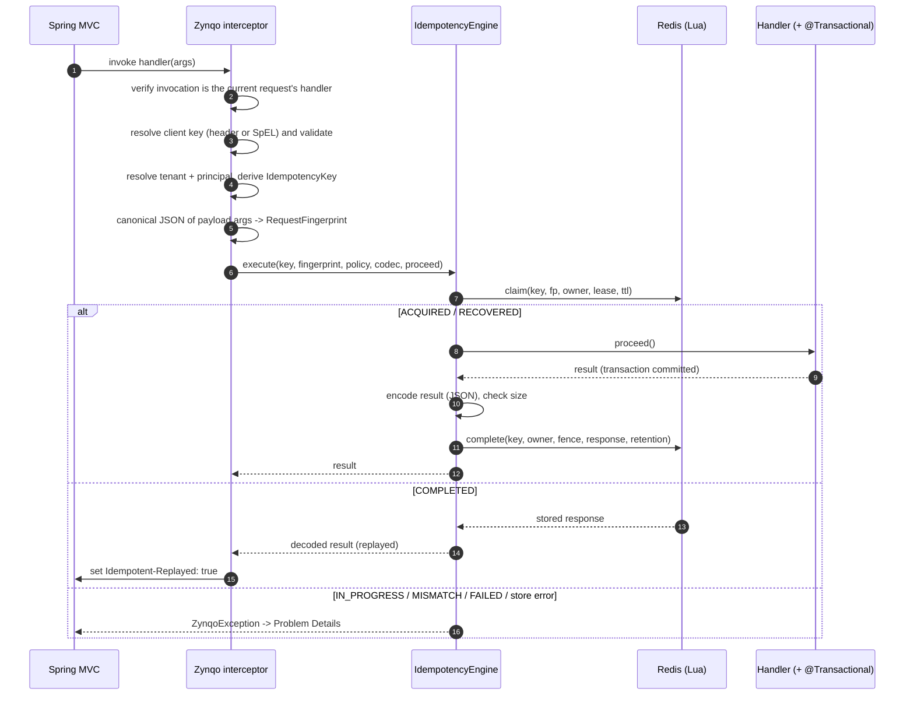

# Architecture

## Modules

| Module | Responsibility | Depends on | Published |
|---|---|---|---|
| `zynqo-core` | Annotation, identity (`IdempotencyKey`, `RequestFingerprint`, `ClientKeyValidator`), storage SPI (`IdempotencyStore`, `ClaimResult`, `OwnershipToken`, `StoredResponse`), the `IdempotencyEngine` state machine, error model, observer SPI | `slf4j-api` | yes |
| `zynqo-storage-redis` | `RedisIdempotencyStore`: four Lua scripts, owner and fence checks, TTLs | core, `spring-data-redis` | yes |
| `zynqo-spring-boot-autoconfigure` | Auto-configuration, `ZynqoProperties`, AOP advisor, Spring MVC integration (key resolution, scoping, fingerprinting, typed replay), startup validation, Problem Details, Micrometer observer | core; optional: redis, webmvc, Jackson 3, Micrometer | yes |
| `zynqo-spring-boot-starter` | Dependency aggregation (autoconfigure + redis + `spring-boot-starter-data-redis`) | — | yes |
| `zynqo-integration-tests` | Multi-instance HTTP tests against real Redis | starter | no |
| `zynqo-examples/zynqo-example-api` | Runnable orders API | starter | no |

`zynqo-core` has no Spring dependency. The engine depends only on the `IdempotencyStore`,
`ResponseCodec`, `ExceptionClassifier`, `ZynqoObserver` and `WaitStrategy` abstractions, which
are inverted dependencies for storage, serialization, failure policy, metrics and time.

## Request flow



## Interception design

Zynqo registers a `DefaultPointcutAdvisor` (role `INFRASTRUCTURE`) that matches methods annotated
with `@Zynqo`, including annotations declared on interfaces. An `ImportBeanDefinitionRegistrar`
calls `AopConfigUtils.registerAutoProxyCreatorIfNecessary`, as `@EnableTransactionManagement` does,
so the advisor is applied even when `spring.aop.auto=false`. The interceptor resolves its
dependencies lazily on first use, so creating the advisor does not initialize the engine or Redis
connections early.

**Ordering.** The advisor order defaults to `1000`:

| Advisor | Order | Effect |
|---|---|---|
| Spring Security method interceptors (`@PreAuthorize` 200, `@Secured` 300, `@PostAuthorize` 500, ...) | 100–600 | Authorization runs **before** Zynqo, so replays are authorized again |
| **Zynqo** | 1000 | |
| `@Transactional`, `@Cacheable` | `Ordered.LOWEST_PRECEDENCE` | The transaction commits **before** Zynqo records completion |

This order is asserted by `ZynqoStartupValidationTest`. URL-based security (the filter chain) runs
before the dispatcher, so it is never bypassed.

### Supported handlers

Every handler method annotated with `@Zynqo` is validated when the application context starts. Any
problem fails startup with a `ZynqoConfigurationException` listing all offending methods.

| Rule | Reason |
|---|---|
| Must be a Spring MVC handler method of a Spring-managed controller | Interception needs a proxy and the request context. Calls of `@Zynqo` methods that are not the handler of the current request (for example a service method called from a controller) are rejected at runtime with `IllegalStateException`. |
| Not `private`, `static` or `final`; class not `final` | CGLIB cannot intercept these |
| Must write the response body (`@RestController`, `@ResponseBody`, or `ResponseEntity`) | View rendering is not replayable |
| Return type not `CompletableFuture`/`CompletionStage`/`Future`/`Callable`, `DeferredResult`, `WebAsyncTask`, `ResponseBodyEmitter`/`SseEmitter`, `StreamingResponseBody`, reactive `Publisher`/Kotlin `Flow`, `Resource`, `InputStream`, `ModelAndView`, `View`, `Optional`, or `HttpEntity` other than `ResponseEntity` | The result must be complete and JSON-serializable when the method returns |
| No `MultipartFile`, `Part`, `@RequestPart`, `InputStream` or `Reader` parameters | These payloads cannot be fingerprinted |
| `key` must be valid SpEL; `lease` and `retention` valid positive durations | Fail fast |
| The controller bean must be proxied with the Zynqo advisor | Guards against silently unprotected handlers |

**Self-invocation** (`this.otherZynqoMethod()`) is not intercepted, which is standard Spring AOP
behaviour. Because only handler methods are supported and they are invoked by MVC through the
proxy, this matters only if application code calls a handler method directly; such calls run
without idempotency.

**Interface-declared annotations** are honoured (`AnnotationMatchingPointcut` with
`checkInherited=true` and merged-annotation lookup).

## Identity

```
IdempotencyKey.id = hex(SHA-256( len|"zynqo/key/v1" | len|tenant | len|principal | len|operation | len|clientKey ))
Redis key         = <zynqo.storage.key-prefix> + "v1:" + id
```

Every field is length-prefixed, so field boundaries cannot be shifted to forge a collision. The
operation defaults to `HTTP_METHOD + " " + best-matching route pattern` (for example
`POST /orders/{id}/cancel`), or the explicit `@Zynqo(operation = ...)`.

```
RequestFingerprint = hex(SHA-256( "zynqo/fingerprint/v1", "http-method", method, "operation", op,
                                  for each payload argument: "arg:<index>:<name>", canonicalJson(arg) ))
```

Payload arguments are those annotated with `@RequestBody`, `@PathVariable`, `@RequestParam` or
`@ModelAttribute`, plus unannotated simple-type arguments (other than `Locale`, `TimeZone` and
`ZoneId`). Headers (including the idempotency key), cookies, principals and servlet objects are
not part of the fingerprint. Canonical JSON sorts object members, strips insignificant whitespace,
normalizes numbers (`1`, `1.0` and `1.00` are equal) and encodes binary as Base64. See
[security.md](security.md#canonicalization-limitations) for limitations.

## Redis record layout

One hash per record:

| Field | Present in | Content |
|---|---|---|
| `state` | all | `IN_PROGRESS`, `COMPLETED`, `FAILED` |
| `fp` | all | request fingerprint (hex) |
| `fence` | all | claim generation, starting at 1 |
| `owner` | `IN_PROGRESS` | random 128-bit owner id of the current claim |
| `lease_until` | `IN_PROGRESS` | lease expiry in ms, from the Redis server clock |
| `status` | `COMPLETED` | HTTP status, or `0` for non-`ResponseEntity` results |
| `headers` | `COMPLETED` | allow-listed headers, `name:value\n` lines |
| `body` | `COMPLETED` (optional) | JSON bytes of the result |

TTL (`PEXPIRE`): in progress, `max(lease, completed-ttl)`; completed, `completed-ttl`; failed,
`failed-ttl`.

Redis atomicity design: [concurrency.md](concurrency.md).

## Extension points

| Bean type | Default | Replace to |
|---|---|---|
| `IdempotencyStore` | `RedisIdempotencyStore` | use another store (must honour the SPI contract) |
| `ZynqoScopeResolver` | principal from `HttpServletRequest#getUserPrincipal`, tenant from `zynqo.scope.tenant-header` | derive tenant/principal from JWT claims, etc. |
| `ZynqoRequestFingerprinter` | canonical JSON of payload arguments | include or exclude request data |
| `ExceptionClassifier` | `zynqo.execution.on-exception` | release on validation errors, mark failed on downstream errors |
| `ZynqoObserver` | Micrometer when a `MeterRegistry` exists, else no-op | custom telemetry |
| `ZynqoProblemDetailsAdvice` | built-in | custom error representation |
