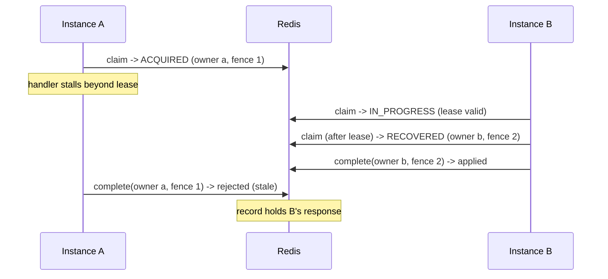

# Concurrency and Redis atomicity

## Atomic operations

Every state transition is one Lua script (`EVALSHA`, falling back to `EVAL`) that touches exactly
one key, so it is atomic with respect to every other client and works with Redis Cluster.

| Script | Preconditions checked atomically | Effect |
|---|---|---|
| `claim.lua` | record absent / fingerprint / state / lease (`TIME`) | create `IN_PROGRESS` (fence 1); or report `MISMATCH`, `COMPLETED` (+ stored response), `FAILED`, `IN_PROGRESS` (+ remaining lease); or take over an expired lease (`HINCRBY fence`, new owner) |
| `complete.lua` | `state == IN_PROGRESS` and `owner` and `fence` match | store status, headers, body; `state = COMPLETED`; drop owner/lease; `PEXPIRE retention` |
| `release.lua` | same | `DEL` |
| `fail.lua` | same | `state = FAILED`; drop owner/lease; `PEXPIRE failed-ttl` |

Lease expiry is evaluated with the Redis server clock (`TIME`) inside the script, so application
clock skew cannot cause two owners. Scripts rely on effects replication (the default since Redis 5
and the only mode since Redis 7).

No `KEYS`, `SCAN` or other multi-key or global commands are used. Records expire through TTLs.

## Ownership and fencing

A worker that lost its lease cannot complete, release or fail the record, because every
transition requires an exact owner **and** fence match. This is verified by
`RedisIdempotencyStoreIT.staleOwnerCannotCompleteReleaseOrFailAfterTakeover` and, over HTTP across
instances, by `MultiInstanceIT.staleOwnerCannotOverwriteTheResultOfTheOwnerThatTookOver`.

### The stale-worker problem

Redis ownership cannot stop a JVM that is still running. If a handler exceeds its lease (GC pause,
slow dependency, network partition), another instance takes over and **executes the operation
again**. The stale worker's side effects still happen; Zynqo only guarantees that its *response*
is not recorded. Mitigations, from most to least robust:

1. **Business invariants:** unique constraints on business identifiers (the example application
   enforces `UNIQUE(owner, reference)`).
2. **Fencing downstream:** store `ZynqoContext.currentFencingToken()` with the data you write and
   reject writes carrying a lower fence (`UPDATE ... WHERE fence < :fence`).
3. **Transactional outbox** for messages; idempotent downstream APIs (pass the key on).
4. **Lease sizing:** set `lease` above the p99.9 execution time, including timeouts of downstream
   calls.

Lease renewal (a heartbeat that extends the lease while the handler runs) is **not implemented**.
It would narrow the window but cannot close it: a partitioned worker cannot renew its lease and
also cannot learn that it lost it.

## Duplicates while in progress

By default (`wait-timeout: 0s`) an in-flight duplicate is rejected immediately with `409` and
`Retry-After` set to the remaining lease (clamped to 1–60 s). With `wait-timeout > 0`, the
duplicate re-runs `claim` every `poll-interval` until the record completes (replay), fails, its
lease expires (takeover) or the wait times out. Waiting holds a servlet thread, so keep it short.
Interrupting a waiting thread ends the wait with `409` and preserves the interrupt flag.

## Verified behaviour

| Scenario | Test |
|---|---|
| 300 concurrent claimants (4 connection pools) → exactly one `ACQUIRED` | `RedisIdempotencyStoreIT.onlyOneOfManyConcurrentClaimantsAcrossInstancesAcquires` |
| 200 concurrent takeovers of an expired lease → exactly one, fence 2 | `RedisIdempotencyStoreIT.concurrentTakeoverOfExpiredLeaseAdmitsExactlyOneNewOwner` |
| 300 concurrent HTTP requests across 3 application instances → 1 execution, 299 × `409` | `MultiInstanceIT.hundredsOfConcurrentDuplicatesAcrossInstancesExecuteExactlyOnce` |
| 300 concurrent callers on the engine → one execution | `IdempotencyEngineTest.hundredsOfConcurrentDuplicatesExecuteOnce` |
| Lease expires on the Redis server clock in real time | `RedisIdempotencyStoreIT.leaseExpiresInRealTimeOnTheServerClock` |
| 40 concurrent requests on the example API → one order | `ExampleApplicationIT.concurrentRequestsCreateExactlyOneOrder` |

Concurrency tests coordinate threads with latches (a coordinated start, and owners held until all
duplicates have been answered), not sleeps. The only time-based waits are Awaitility polls for
Redis TTL and lease expiry, where real elapsed time is the behaviour under test.
